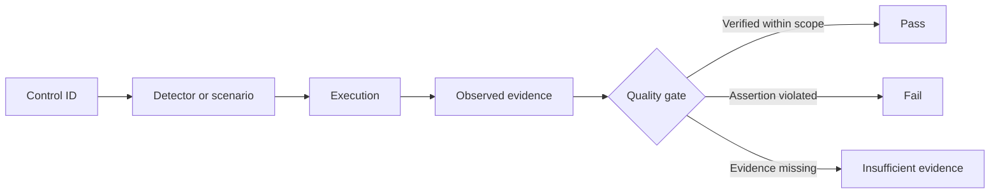
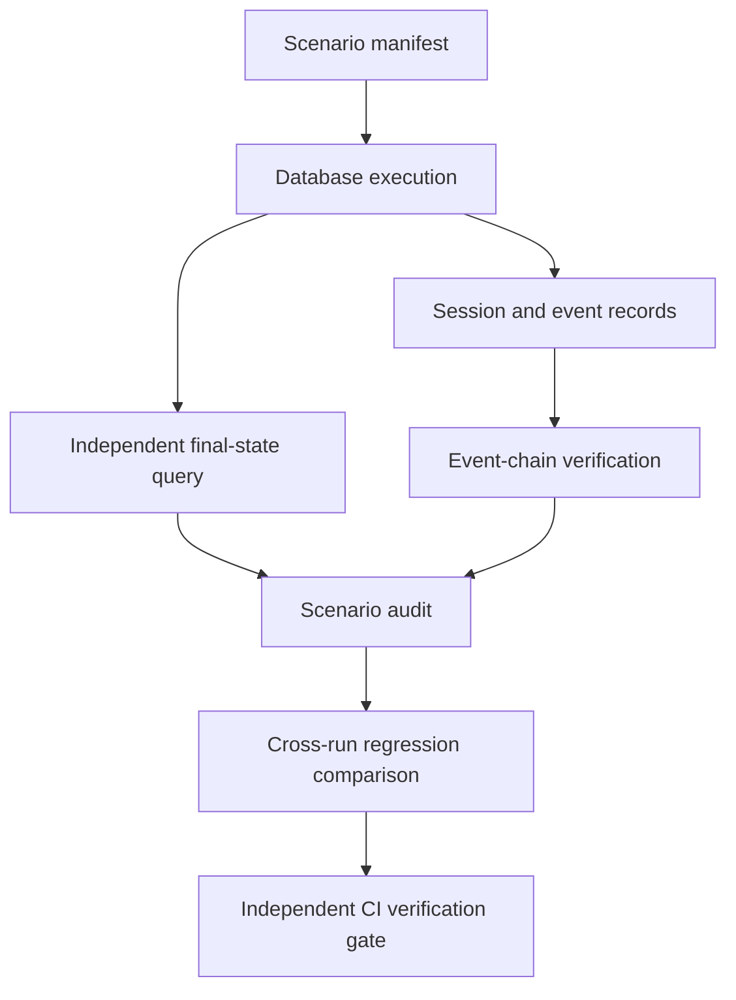

<div align="center">

# Backend Engineering Assurance

**Know what your backend actually proves.**

*Executable engineering controls · Transaction scenarios · Evidence-aware quality gates*


[Get started](#quick-start) · [Explore capabilities](#what-it-can-check) · [Transaction testing](#transaction-scenarios) · [Evidence model](#evidence-is-the-product) · [Documentation](#documentation)

</div>

---

## The problem

A green test suite does not necessarily prove that a backend is safe under concurrency, tenant boundaries, failed transactions, or production-like database behavior.

**Backend Engineering Assurance** turns engineering expectations into explicit controls, executable checks, and inspectable evidence. It distinguishes *observed behavior* from *unverified assumptions*—and refuses to silently turn missing evidence into a pass.

> **Current verification status:** The repository contains 85 documented controls, but only a subset has implemented automated detectors. Local automated tests have passed in prior packaging runs; **PostgreSQL/MySQL Docker integration has not been verified in the packaging environment**. Treat real-database CI as pending until its artifacts are available.

## At a glance

| | What you get |
|---|---|
| **85 control definitions** | A structured engineering catalog; not 85 fully automated checks |
| **Static analysis** | TypeScript AST, dependencies, call graphs, architecture boundaries and candidate detectors |
| **Behavioral testing** | Authorization negative tests and concurrent idempotency observations against isolated test services |
| **SQL correctness** | NULL semantics, JOIN cardinality, query-plan assertions and scoped transaction checks |
| **Transaction scenarios** | Lost update, non-repeatable read, phantom read, serialization/deadlock and retry recovery manifests |
| **Evidence & gates** | Control IDs, execution records, event hash chains, audit/replay and regression comparison |
| **CI integration** | Disposable PostgreSQL/MySQL workflow definitions with independent evidence gate stages |

## How it works



**The rule:** a declared control is not a verified control. A configured CI job is not proof that it ran. A hash or signature proves integrity only within its actual trust boundary.

## Quick start

**Requirements:** Node.js 20 or newer. Database testing additionally requires Docker, isolated credentials, and explicit opt-in.

```bash
npm install
npm test

# Inspect a local backend repository
node bin/backend-guard.mjs inventory --root ./service

# Generate a static analysis report
node bin/backend-guard.mjs check \
  --root ./service \
  --format json \
  --output analysis.json

# Evaluate the declared control profile
node bin/backend-guard.mjs assess \
  --root ./service \
  --report analysis.json \
  --profile profiles/production.json
```

The production profile may return **insufficient evidence** when required proof is absent. This is expected fail-closed behavior, not a successful certification.

### Try a focused detector

```bash
node bin/backend-guard.mjs detect-controls \
  --root ./service \
  --contract examples/domain-boundary.contract.json \
  --output domain-result.json
```

Edit the contract to match your repository's actual domain boundaries. Example policies are not universal project defaults.

## What it can check

| Area | Example verification | Important boundary |
|---|---|---|
| Architecture | Forbidden direct domain-to-infrastructure imports; dependency cycles | Indirect/runtime dependencies may be outside detector scope |
| API behavior | Cross-tenant access denied to another identity | Requires a running isolated service and configured test identities |
| Idempotency | Concurrent duplicate requests and side-effect probes | Does not prove every crash/recovery path |
| Database | SQL assertions, transactions, lock evidence, final-state probes | Real engine behavior requires actual PostgreSQL/MySQL execution |
| Migration | Candidate destructive migration patterns | A candidate finding is not a confirmed unsafe migration |
| Cost | Bounded benchmark cases and architecture regressions | Not a global performance or security score |
| Provenance | Event chains, audit, replay and CI signing hooks | Independent trust requires separately managed signing keys |

## Transaction scenarios

Five scenario families are represented by executable manifests and a scenario runner. The runner is designed to collect the **schedule, outcome, independent final-state observation and applicable database evidence** for each case.

| Scenario | Core question |
|---|---|
| **Lost update** | Did concurrent writers overwrite a committed change? |
| **Non-repeatable read** | Did a repeated read observe a committed change within the transaction? |
| **Phantom read** | Did a predicate query return a different qualifying set? |
| **Serialization failure / deadlock** | Was the expected conflict classified at the actual failure point? |
| **Retry recovery** | Did rollback and bounded retry preserve the required durable state? |

```bash
# Unit and mocked-driver regression tests
npm test

# Requires Docker and an explicitly disposable database environment
BACKEND_GUARD_INTEGRATION_OPT_IN=yes npm run test:real-db:v40
```

The real-database script is designed to create fresh PostgreSQL/MySQL instances, run the scenarios twice, audit each run, and compare evidence. **It must actually complete successfully before claiming a validated database baseline.**

For individual engine manifests, see [`examples/`](examples/) and [`references/real-db-acceptance-v39.md`](references/real-db-acceptance-v39.md).

## Evidence is the product



An evidence report can describe **what ran**, **which Control ID it addresses**, **what the database returned**, and **why the gate accepted or rejected the observation**. Evidence must not be promoted beyond its measured scope.

```bash
# Audit an existing report against its exact manifest
node bin/backend-guard.mjs scenario-audit \
  --manifest examples/anomaly-postgres-v39.json \
  --report artifacts/real-db-v39/postgres.json \
  --output artifacts/real-db-v39/postgres.audit.json

# Re-run and compare against a previous observation
node bin/backend-guard.mjs scenario-replay \
  --manifest examples/anomaly-postgres-v39.json \
  --baseline artifacts/real-db-v39/postgres.json \
  --output artifacts/real-db-v39/postgres.replay.json
```

These commands require the referenced reports, test data, database access, and manifest configuration; the paths above are **outputs of an earlier integration run**, not bundled evidence.

## Understand the gate results

| Outcome | Meaning |
|---|---|
| `pass_within_declared_scope` / observed limited pass | Specified assertions were observed within the configured scope |
| `fail` | An executed assertion or blocking control failed |
| `insufficient_evidence` | Required execution, identity, telemetry or proof was unavailable |
| Invalid configuration | Manifest, profile or input cannot be safely evaluated |

**Do not interpret any pass as blanket backend compliance.** Exit codes vary by command; consult [`SPEC.md`](SPEC.md) for the command-specific contract.

## Project structure

```text
backend-engineering-plugin/
├── bin/             # CLI entrypoints and evidence gates
├── lib/             # Detectors, runners, audit and regression logic
├── rules/           # Control catalog and detector registry
├── profiles/        # Quality-gate profiles
├── examples/        # Policies and scenario manifests
├── references/      # Engineering execution contracts
├── tests/           # Automated regression tests
├── ci/              # Integration scripts
├── .github/workflows/ # Database CI workflow definitions
├── SKILL.md         # Agent-facing operating instructions
├── SPEC.md          # Detailed behavior and limitations
└── README.md
```

## Use it as an engineering skill

Start with [`SKILL.md`](SKILL.md), then [`references/engineering-workflow.md`](references/engineering-workflow.md). Choose the relevant control references, define the invariant and negative test, execute the matching detector or harness, and record both **observed evidence** and **unverified requirements**.

## Documentation

| Resource | Read this when… |
|---|---|
| [`SKILL.md`](SKILL.md) | You want an agent to follow the engineering workflow |
| [`SPEC.md`](SPEC.md) | You need command contracts, statuses and limitations |
| [`rules/control-catalog.json`](rules/control-catalog.json) | You need the declared engineering controls |
| [`rules/detector-registry.json`](rules/detector-registry.json) | You need to distinguish implemented detectors from unimplemented controls |
| [`references/`](references/) | You need detailed API, architecture, SQL, transaction or evidence standards |
| [`docs/VERSION_HISTORY.md`](docs/VERSION_HISTORY.md) | You need the detailed v2.3–v4.0 evolution and older commands |

## Safety and limitations

- **Never run database mutation scenarios against production.** Use disposable databases and least-privilege credentials.
- **Local execution is not a sandbox.** Inspect scripts and manifests before granting access.
- **Real-database compatibility is unverified until CI artifacts demonstrate it.** Mocked-driver tests cannot substitute for server execution.
- **A successful scenario is scoped evidence, not certification.** The 85-control catalog does not imply 85 implemented or passing detectors.
- **Evidence signatures have a trust boundary.** An independently controlled CI identity and secret are required for meaningful provenance.

---

<div align="center">

**Build the control. Run the test. Inspect the evidence.**

[Back to top](#backend-engineering-assurance)

</div>
